  

  
  
  

## Sobre mim

Desenvolvedor Full Stack na **Bloco Construções**, onde desenvolvo e mantenho sistemas internos e PWAs para diferentes áreas da empresa, do levantamento de requisitos à implantação.

- **IA nos produtos:** separação automática de contracheques, lembretes de pagamento por WhatsApp e central de chamados com IA.
- **Segurança:** autenticação, permissões e Row Level Security, seguindo boas práticas e a LGPD.
- **Formação:** formado em Sistemas para Internet pela Unipê e cursando Engenharia de Software.
- **Em aprofundamento:** AWS.

## Stack

  FRONT-END 
  

  BACK-END E DADOS 
  

  FERRAMENTAS 
  

## Projetos em destaque

<table>
  <tr>
    <td width="50%" valign="top">
      <strong>TechStation E-commerce</strong> 
      Loja virtual de hardware de alta performance e setups completos.  
      <a href="https://techstation-ecommerce.vercel.app/">Site</a> · <a href="https://github.com/nielsongomesdev/techstation-ecommerce">Código</a>
    </td>
    <td width="50%" valign="top">
      <strong>MFRP · Gestão de lanchonete</strong> 
      Sistema de pedidos, caixa e administração para uma lanchonete.  
      <a href="https://mfrp-ten.vercel.app/login">Site</a>
    </td>
  </tr>
  <tr>
    <td width="50%" valign="top">
      <strong>S&amp;M PsyBookings</strong> 
      Landing page para uma agência de bookings de psytrance.  
      <a href="https://sm-psybookings.com/">Site</a> · <a href="https://github.com/nielsongomesdev/SM-PsyBookings">Código</a>
    </td>
    <td width="50%" valign="top">
      <strong>GitHub Search</strong> 
      Busca de usuários e repositórios consumindo a API pública do GitHub.  
      <a href="https://github-search-test-three.vercel.app/">Site</a> · <a href="https://github.com/nielsongomesdev/github-search-test">Código</a>
    </td>
  </tr>
</table>

## Atividade no GitHub

  

  
  

  
  

